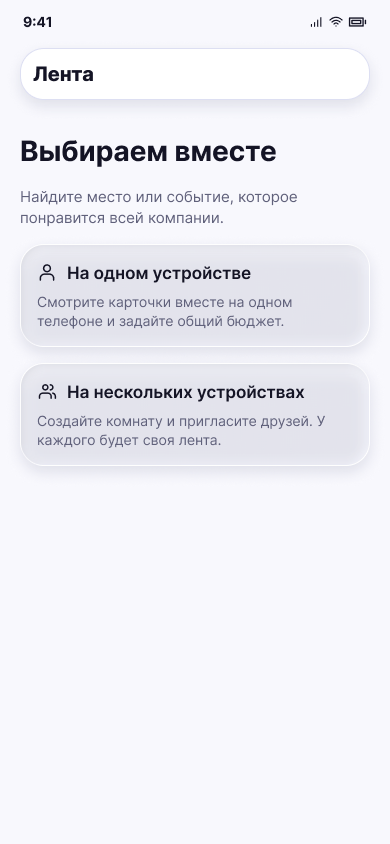

# Выбор устройства

**Фрейм:** [280-10679](https://www.figma.com/design/khewsPf7b4JVyBwJaCmO43/startap_design?node-id=280-10679). **Эталон:** 390 × 844 px. **Сценарий:** [полный UI-прогон](README.md).

## Вход и состояние

Вход с плитки «Свайпать события»; тип подборки «События» передаётся дальше как начальный.

## Видимые элементы

TopBar «Лента»; заголовок «Выбираем вместе» и пояснение; два крупных варианта «На одном устройстве» и «На нескольких устройствах» с иконкой и двухстрочным описанием.

## Действия и переходы

Первый вариант → экран 03; второй → экран 10. Возврат → «Открытия».

## Проверка UI

Обе карточки имеют одинаковую ширину, читаемый текст и полноценную область нажатия; в экспортированном фрейме нижнего таб-бара нет.

