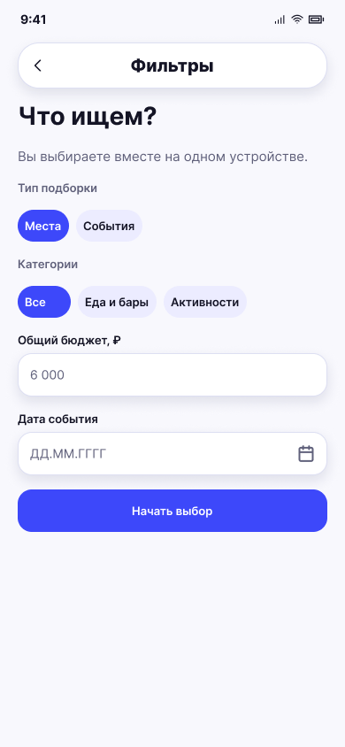

# Общие фильтры

**Фрейм:** [280-10774](https://www.figma.com/design/khewsPf7b4JVyBwJaCmO43/startap_design?node-id=280-10774). **Эталон:** 390 × 844 px. **Сценарий:** [полный UI-прогон](README.md).

## Вход и состояние

Выбран режим одного устройства; при входе через «Свайпать события» активен чип «События».

## Видимые элементы

TopBar «Фильтры» и стрелка назад; заголовок «Что ищем?»; подсказка про одно устройство; группы «Тип подборки», «Категории»; поле «Общий бюджет, ₽»; поле даты события; синяя кнопка «Начать выбор».

## Действия и переходы

Изменение чипов и полей сохраняет выбор в UI; «Начать выбор» → экран 05 для событий или 04 для мест. Назад → 02. Возврат с карточки открывает заполненные фильтры.

## Проверка UI

Активные чипы синие, неактивные светлые; поля и кнопка выровнены по общей сетке; при выборе «Места» дата скрывается по текущей логике.

