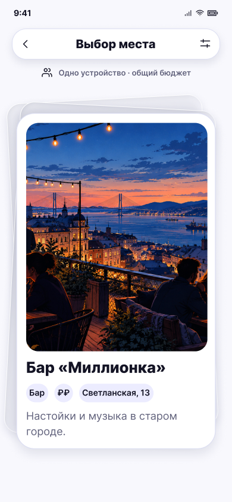

# Карточка места · одно устройство

**Фрейм:** [280-10836](https://www.figma.com/design/khewsPf7b4JVyBwJaCmO43/startap_design?node-id=280-10836). **Эталон:** 390 × 844 px. **Сценарий:** [полный UI-прогон](README.md).

## Вход и состояние

Фильтры завершены с типом «Места», есть текущая карточка пула.

## Видимые элементы

TopBar «Выбор места»: назад слева, фильтры справа; строка «Одно устройство · общий бюджет»; по центру стопка из двух подложек и активной белой карточки с большим фото, названием, чипами и описанием.

## Действия и переходы

Свайп влево пропускает и выводит следующую карточку; свайп вправо открывает 06; фильтр → 03; назад возвращает по существующей навигации. Последняя пропущенная карточка → 07.

## Проверка UI

Фотография обрезана по скруглению без растяжения; подложки видны сверху и сбоку; нет кнопок, счётчика и шкалы прогресса. Жест начинается на теле карточки.

