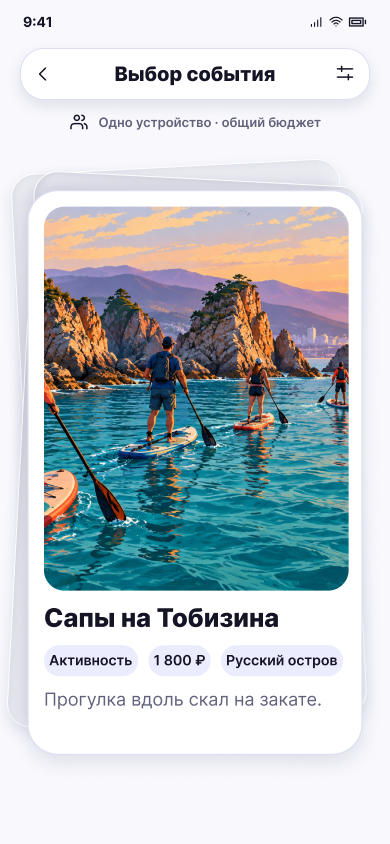

# Карточка события · одно устройство

**Фрейм:** [280-10862](https://www.figma.com/design/khewsPf7b4JVyBwJaCmO43/startap_design?node-id=280-10862). **Эталон:** 390 × 844 px. **Сценарий:** [полный UI-прогон](README.md).

## Вход и состояние

Фильтры завершены с типом «События».

## Видимые элементы

Та же компоновка, что у 04, с заголовком «Выбор события»; пример «Сапы на Тобизина»: крупное фото, название, чипы категории, цены и места, краткое описание.

## Действия и переходы

Свайп влево → следующая карточка или 07; вправо → 06 с событием; фильтр → 03. Отмена прошлого решения работает по текущей логике и возвращает карточку в ту же позицию.

## Проверка UI

Заголовок и чипы не наезжают на фото/описание; карточка остаётся в пределах безопасной области. Нет дополнительных кнопок и прогресса.

