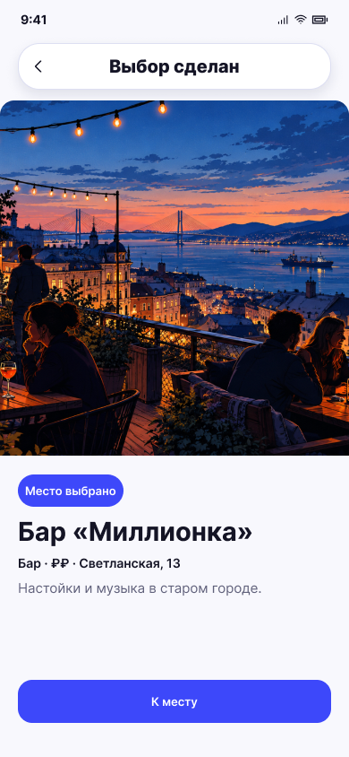

# Выбор сделан

**Фрейм:** [280-10985](https://www.figma.com/design/khewsPf7b4JVyBwJaCmO43/startap_design?node-id=280-10985). **Эталон:** 390 × 844 px. **Сценарий:** [полный UI-прогон](README.md).

## Вход и состояние

В одиночном режиме выполнен лайк карточки.

## Видимые элементы

TopBar «Выбор сделан»; широкая обложка сразу под ним; ниже синий чип «Место выбрано» для примера места, название, строка параметров и описание; большая кнопка «К месту» у нижней части экрана.

## Действия и переходы

«К месту» / «К мероприятию» → детали выбранного объекта по уже существующей логике; назад → предыдущий шаг по навигации приложения.

## Проверка UI

Это полноэкранный результат, а не карточка из стопки. Фото занимает всю ширину, кнопка не перекрывается системным нижним inset; тип и текст кнопки соответствуют выбранному объекту.

