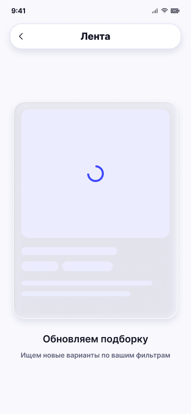

# Обновление подборки

**Фрейм:** [280-11049](https://www.figma.com/design/khewsPf7b4JVyBwJaCmO43/startap_design?node-id=280-11049). **Эталон:** 390 × 844 px. **Сценарий:** [полный UI-прогон](README.md).

## Вход и состояние

Последняя карточка текущей порции пропущена; идёт загрузка следующей.

## Видимые элементы

TopBar «Лента»; в центре вертикальный скелетон карточки с крупной заглушкой фото, линиями текста и синим спиннером; под ним «Обновляем подборку» и «Ищем новые варианты по вашим фильтрам».

## Действия и переходы

Успех с новыми карточками → 08; пустая выдача → 09. Во время загрузки свайпы и действия карточки недоступны.

## Проверка UI

Не показывать старую активную карточку и её действия; спиннер анимирован, скелетон остаётся на месте без скачка размеров.

