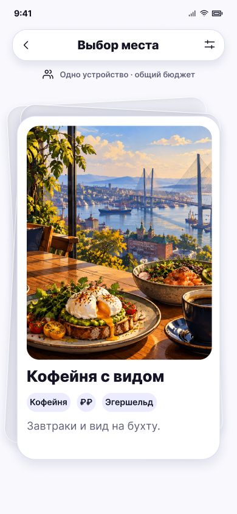

# Первая карточка новой подборки

**Фрейм:** [280-11023](https://www.figma.com/design/khewsPf7b4JVyBwJaCmO43/startap_design?node-id=280-11023). **Эталон:** 390 × 844 px. **Сценарий:** [полный UI-прогон](README.md).

## Вход и состояние

Загрузка следующей порции завершилась, есть новые варианты.

## Видимые элементы

TopBar «Выбор места»; строка режима; стопка и активная карточка «Кофейня с видом» с новым фото, чипами и описанием.

## Действия и переходы

Дальше работают те же жесты и переходы, что на 04/05; тип заголовка зависит от подборки.

## Проверка UI

Скелетон заменяется готовой стопкой без появления пустого кадра; геометрия карточки совпадает с 04/05. Пример изображения служит проверке компоновки.

