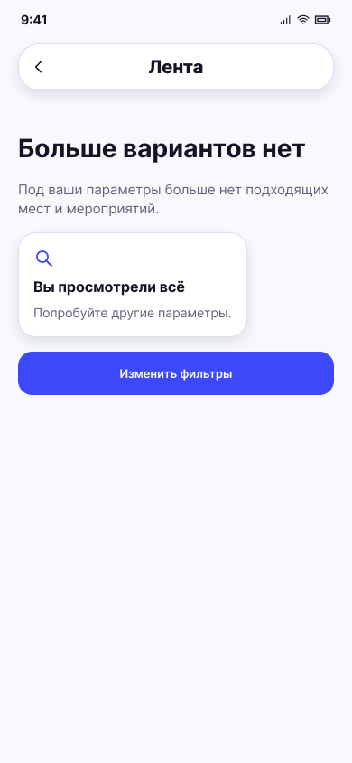

# Больше вариантов нет

**Фрейм:** [280-10943](https://www.figma.com/design/khewsPf7b4JVyBwJaCmO43/startap_design?node-id=280-10943). **Эталон:** 390 × 844 px. **Сценарий:** [полный UI-прогон](README.md).

## Вход и состояние

Новых карточек нет.

## Видимые элементы

TopBar «Лента»; заголовок «Больше вариантов нет»; пояснение «Под ваши параметры больше нет подходящих мест и мероприятий»; статусная белая карточка «Вы просмотрели всё»; синяя кнопка «Изменить фильтры».

## Действия и переходы

Кнопка → 03 или 13 согласно текущему режиму, с сохранёнными значениями; назад — по существующей навигации.

## Проверка UI

Пустое состояние занимает верхнюю часть экрана; нет стопки, скелетона и свайп-действий.

