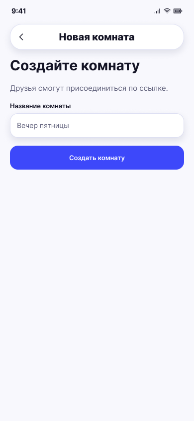

# Создание комнаты

**Фрейм:** [280-10707](https://www.figma.com/design/khewsPf7b4JVyBwJaCmO43/startap_design?node-id=280-10707). **Эталон:** 390 × 844 px. **Сценарий:** [полный UI-прогон](README.md).

## Вход и состояние

На экране 02 выбран вариант нескольких устройств.

## Видимые элементы

TopBar «Новая комната»; заголовок «Создайте комнату»; подпись о присоединении друзей; поле «Название комнаты» с примером «Вечер пятницы»; синяя кнопка «Создать комнату».

## Действия и переходы

Ввод названия и создание → 11; назад → 02; ошибка поля показывается по UI Kit.

## Проверка UI

В отличие от выбора режима таб-бар скрыт; контент стоит в верхней части экрана, ширина поля и кнопки одинаковая.

