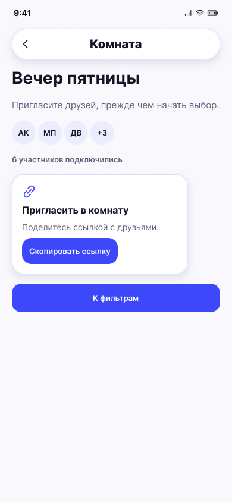

# Приглашение в комнату

**Фрейм:** [280-10728](https://www.figma.com/design/khewsPf7b4JVyBwJaCmO43/startap_design?node-id=280-10728). **Эталон:** 390 × 844 px. **Сценарий:** [полный UI-прогон](README.md).

## Вход и состояние

Комната создана организатором.

## Видимые элементы

TopBar «Комната»; название комнаты; подсказка «Пригласите друзей, прежде чем начать выбор»; группа аватаров и счётчик участников; белый блок «Пригласить в комнату» с иконкой ссылки, пояснением и кнопкой «Скопировать ссылку»; ниже «К фильтрам».

## Действия и переходы

Скопировать → 12; «К фильтрам» → 13 для каждого участника, включая приглашённого; назад → предыдущий экран. Это целевой переход после обновления серверного контракта; сегодня фильтры доступны только организатору.

## Проверка UI

Число и аватары обновляются без изменения общей сетки; длинное название комнаты не перекрывает контент. **Требует макета:** приглашённый участник и состояние готовности фильтров остальных пока не нарисованы.

