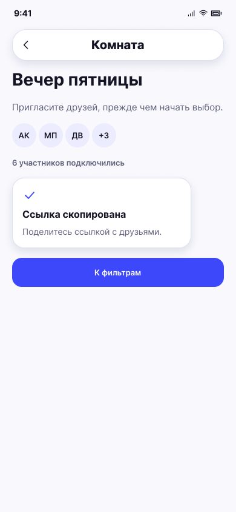

# Ссылка скопирована

**Фрейм:** [280-10751](https://www.figma.com/design/khewsPf7b4JVyBwJaCmO43/startap_design?node-id=280-10751). **Эталон:** 390 × 844 px. **Сценарий:** [полный UI-прогон](README.md).

## Вход и состояние

На 11 нажата кнопка копирования ссылки.

## Видимые элементы

Та же шапка и сведения комнаты; приглашение становится компактным белым блоком с галочкой, заголовком «Ссылка скопирована» и пояснением; кнопка «К фильтрам» под ним.

## Действия и переходы

Продолжить → 13 для организатора; приглашённый переходит к собственным фильтрам из лобби 11. Повторное копирование и длительность состояния — по текущей логике приложения.

## Проверка UI

Блок действительно меняет содержимое и высоту; подтверждение доступно без toast поверх кнопки.

