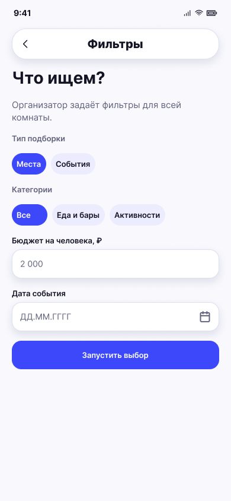

# Фильтры комнаты

**Фрейм:** [280-10805](https://www.figma.com/design/khewsPf7b4JVyBwJaCmO43/startap_design?node-id=280-10805). **Эталон:** 390 × 844 px. **Сценарий:** [полный UI-прогон](README.md).

## Вход и состояние

Участник комнаты, включая организатора, перешёл из лобби к собственным параметрам. Сервер должен собрать ответы участников и только затем сформировать общий пул; текущая серверная реализация этого не поддерживает.

## Видимые элементы

TopBar «Фильтры»; «Что ищем?»; на существующем фрейме подпись «Организатор задаёт фильтры для всей комнаты»; тип подборки, категории, «Бюджет на человека, ₽», дата события, кнопка «Запустить выбор». Подпись и действие отражают старый сценарий: для целевого сценария каждому участнику нужен свой вариант экрана с отправкой фильтров и состоянием ожидания остальных.

## Действия и переходы

Каждый участник выбирает и отправляет свои параметры. До получения ответов остальных нельзя показывать общий пул; после серверного объединения → 14/15. Назад → лобби 11/12 согласно роли. Точное правило объединения и условия запуска требуют решения в серверном контракте.

## Проверка UI

Активные чипы синие; поле бюджета подписано «Бюджет на человека, ₽». **Требует нового макета:** текст для приглашённого, название кнопки отправки и экран ожидания. Нельзя применять старое правило общего бюджета комнаты к персональному вводу без определения серверного объединения.

