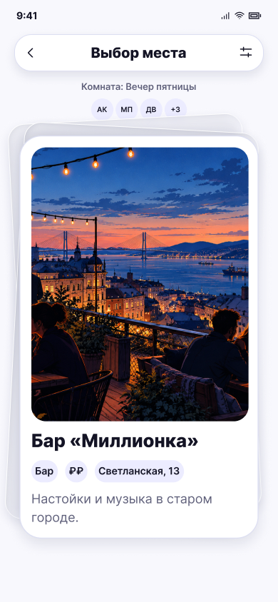

# Карточка места · комната

**Фрейм:** [280-10889](https://www.figma.com/design/khewsPf7b4JVyBwJaCmO43/startap_design?node-id=280-10889). **Эталон:** 390 × 844 px. **Сценарий:** [полный UI-прогон](README.md).

## Вход и состояние

В комнате начался раунд мест.

## Видимые элементы

TopBar «Выбор места» с фильтром; строка «Комната: Вечер пятницы»; ряд аватаров; стопка карт и место «Бар «Миллионка»».

## Действия и переходы

Свайп влево/вправо фиксирует решение и показывает следующую карточку. После последней → 16; при общем результате → 17. Кнопка фильтра доступна только по текущим правилам роли.

## Проверка UI

Ряд аватаров не перекрывает верх стопки; фото и текст карточки соответствуют сетке 04. Нет кнопок и прогресса.

