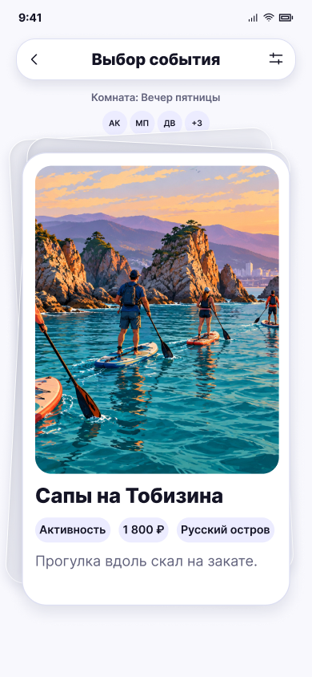

# Карточка события · комната

**Фрейм:** [280-10916](https://www.figma.com/design/khewsPf7b4JVyBwJaCmO43/startap_design?node-id=280-10916). **Эталон:** 390 × 844 px. **Сценарий:** [полный UI-прогон](README.md).

## Вход и состояние

В комнате начался раунд событий.

## Видимые элементы

TopBar «Выбор события» с фильтром; строка комнаты и аватары; стопка карт и событие «Сапы на Тобизина» с фото, чипами и описанием.

## Действия и переходы

Оба направления свайпа переходят к следующему кандидату; после последней карточки → 16, при результате → 17.

## Проверка UI

Стопка, отступы и зона жеста повторяют 14; динамическая высота текста не должна обрезать описание.

