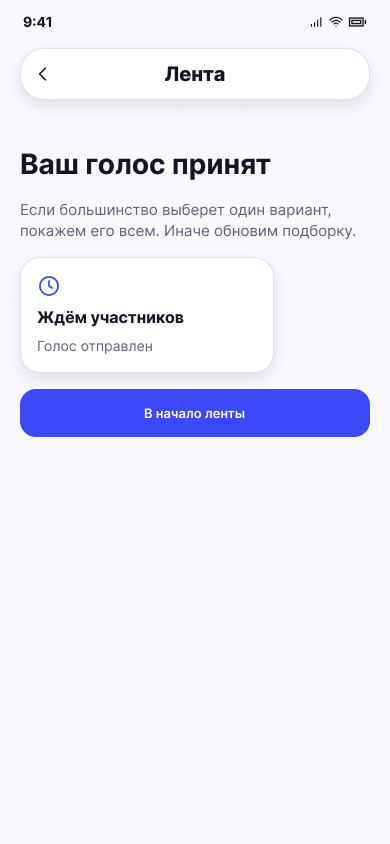

# Ожидание остальных

**Фрейм:** [280-10964](https://www.figma.com/design/khewsPf7b4JVyBwJaCmO43/startap_design?node-id=280-10964). **Эталон:** 390 × 844 px. **Сценарий:** [полный UI-прогон](README.md).

## Вход и состояние

Участник прошёл все карточки, итог комнаты ещё не готов.

## Видимые элементы

TopBar «Лента»; заголовок «Ваш голос принят»; пояснение про выбор большинством или обновление подборки; статусная карточка «Ждём участников» / «Голос отправлен»; кнопка «В начало ленты».

## Действия и переходы

При результате комната автоматически показывает 17; при новом раунде → 07 и затем 14/15; кнопка возвращает к выбору режима по текущей логике.

## Проверка UI

Состояние статично и не допускает новых свайпов; при изменении статуса переход выполняется без ручного обновления.

