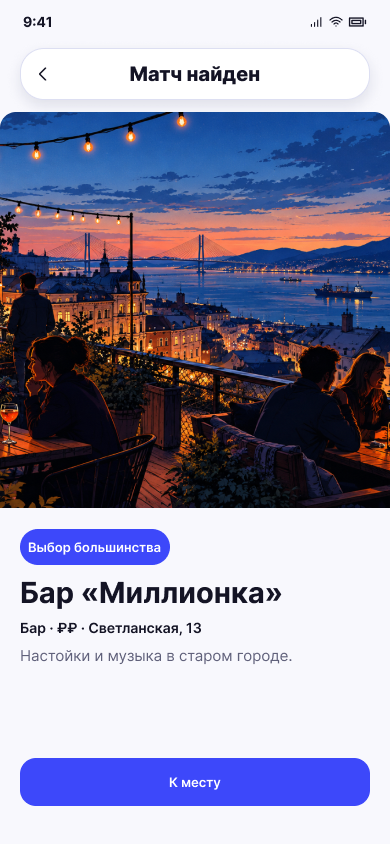

# Матч найден

**Фрейм:** [280-11004](https://www.figma.com/design/khewsPf7b4JVyBwJaCmO43/startap_design?node-id=280-11004). **Эталон:** 390 × 844 px. **Сценарий:** [полный UI-прогон](README.md).

## Вход и состояние

Серверный итог комнаты содержит выбранный объект.

## Видимые элементы

TopBar «Матч найден»; фото на всю ширину; синий чип «Выбор большинства»; название, параметры, описание; нижняя кнопка «К месту» / «К мероприятию».

## Действия и переходы

Кнопка → детали объекта; назад — по текущей навигации комнаты.

## Проверка UI

Полноэкранная композиция повторяет 06, но метка и заголовок относятся к общему результату. Все участники видят одинаковый объект.

